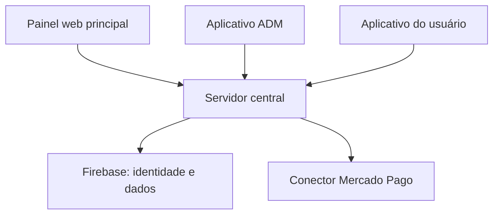

# Comunicação entre web, ADM e usuários

Decisão incorporada em 20/11/2026, horário de São Paulo.

O painel web é o centro de controle. O servidor é a autoridade que executa as regras. O aplicativo ADM é outro cliente administrativo, com os mesmos registros da plataforma. O aplicativo do usuário só executa operações autorizadas para a conta autenticada.

A plataforma continua operando mesmo com o navegador do proprietário fechado, desde que a hospedagem e os serviços estejam disponíveis. O aplicativo ADM não depende de um computador ligado. Seus comandos passam pelo servidor, e o painel web vê os resultados ao consultar a mesma base.

## Permissões

| Conta | Operações |
| --- | --- |
| Proprietário | Configurações, integrações, taxas, permissões, repasses, projetos e toda a operação |
| Administrador operacional | Moderação de produtos, atendimento de pedidos, etapas de entrega e novidades |
| Vendedor | Perfil, cadastro/edição dos próprios produtos, vinculação de recebimento e acompanhamento dos próprios pedidos |
| Afiliado | Links dos produtos, comissões e repasses da própria conta |
| Comprador | Compra ou solicitação assistida e acompanhamento dos próprios pedidos |

Instalar o APK ADM não concede permissão administrativa. A decisão usa o ID token validado no servidor e o perfil armazenado. O proprietário é reconhecido pelo e-mail definido em `ADMIN_EMAIL`, com verificação do e-mail exigida. A área do usuário também pode ser aberta pelo proprietário para conferir a experiência.

## Configurações compartilhadas

O documento `samConecta/v1/settings/public` guarda catálogo, manutenção, afiliados, projetos, pagamentos, categorias, taxa e textos. Cada alteração incrementa a revisão. Uma gravação com revisão antiga é recusada para não sobrescrever o trabalho de outro administrador.

As telas consultam atualizações a cada 20 segundos quando visíveis e ao recuperar o foco. As operações consultam a configuração no servidor. Desabilitar pagamentos ou suspender um usuário passa a bloquear os novos comandos mesmo se uma tela antiga ainda mostra um botão.

Taxas e valores são copiados para o pedido no momento da criação. Alterações posteriores valem para os pedidos novos e não reescrevem vendas anteriores.

## Credenciais

O Firebase inicial é configurado no ambiente da hospedagem: a plataforma precisa de identidade e base para abrir o painel. Depois disso, o proprietário cadastra as credenciais Mercado Pago pelo painel web ou pela área proprietária no aplicativo ADM.

Não é possível provar que um comando veio de um navegador apenas pelo nome do aplicativo ou por um cabeçalho. A proteção real é a identidade e a permissão do proprietário. Os canais não possuem autoridades conflitantes; todos usam a mesma API.

Tokens Mercado Pago e tokens OAuth dos vendedores ficam cifrados com AES-256-GCM. A chave de 32 bytes permanece no servidor, separada do Firestore. Leituras do painel retornam apenas se os campos foram preenchidos. A troca de credenciais pausa pagamentos até um novo teste e reativação.

## Pedidos, indicação e estoque

Cada checkout corresponde a um produto e um vendedor. Não há carrinho de múltiplos vendedores nesta versão. A indicação é de um único afiliado, no produto do link. O comprador e o vendedor não podem receber comissão pela própria compra/venda.

O servidor usa o preço do produto, reserva uma unidade em transação e cria o pedido com chave de idempotência. Repetir a mesma solicitação não cria outra reserva. O valor enviado pelo navegador não define o preço.

O vendedor recebe o valor descontado da taxa da plataforma, da comissão do afiliado quando houver e das tarifas do próprio provedor. No split 1:1, a parte da plataforma e do afiliado é cobrada como `marketplace_fee`; a plataforma mantém a obrigação do repasse ao afiliado. Não há split automático para três beneficiários.

Uma venda de carro, casa ou outro bem que use `Negociação assistida` gera um pedido de atendimento. A equipe registra a conclusão somente após conferir o recebimento externo e informar a referência. Não se marca “pago” apenas porque um usuário demonstrou interesse.

## Pagamentos e retorno

O checkout recebe as três URLs de retorno: sucesso, pendência e falha. A página exibe o estado registrado pela central e pode voltar ao APK por deep link. O botão de retorno continua disponível se o navegador bloquear a abertura automática.

O estado na URL não autoriza crédito. O webhook tem assinatura HMAC validada e a API do provedor é consultada. Referência, recebedor, valor, moeda e ambiente precisam corresponder ao pedido.

Eventos repetidos não geram outra comissão. Eventos antigos não regridem o pedido. Um segundo pagamento aprovado é sinalizado para revisão, sem duplicar a comissão principal. Estorno parcial reduz a comissão proporcionalmente; estorno total ou contestação retiram a comissão apurada. Um repasse já realizado continua registrado e pode gerar diferença negativa.

O botão de consulta no pedido reconcilia a situação no provedor. A implementação não inicia estornos nem transfere os repasses do afiliado.

## Trocar o banco

Trocar a chave de um banco não transfere usuários, pedidos, saldos, imagens ou configurações. Firebase Authentication, Firestore e Storage são serviços distintos. Uma migração precisa definir quais serão substituídos.

O processo de migração previsto é: implementar o adaptador do destino, exportar/copiar dados, mapear identidade e identificadores, comparar os resultados, testar permissões e pagamentos, realizar o corte controlado e conservar um caminho de retorno. A rota de troca de banco recusa a ativação direta e preserva a base atual.

## Novos métodos de pagamento

O painel lista capacidades por conector. Firebase e Mercado Pago possuem implementação. Stripe, Asaas e outros provedores precisam do próprio adaptador no servidor, testes e interface de credenciais adequada. Um endpoint HTTP genérico não é tratado como gateway universal.

## Aportes futuros

O proprietário consegue preparar projetos no ADM e escolher quando publicá-los. A visibilidade global também depende da configuração `projectsEnabled`. As estimativas são campos informativos separados dos recebimentos.

Nesta versão, o usuário registra interesse. O sistema não recebe aportes, cria participação imobiliária, calcula rentabilidade real, distribui rendimentos ou registra propriedade. Essas operações exigem um módulo financeiro e um modelo de dados próprios antes da ativação de dinheiro real.
